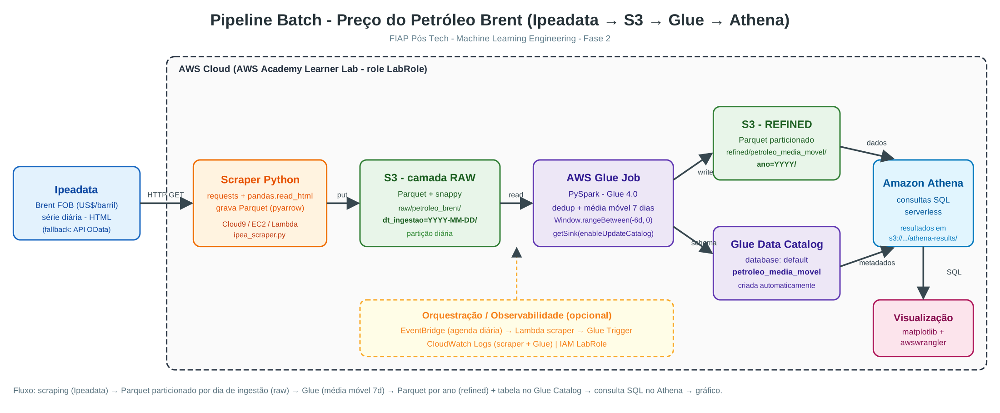

# Pipeline Batch – Preço do Petróleo Brent (Ipeadata → S3 → Glue → Athena)

Prova Substitutiva Fase 2 – Pós-Graduação em Machine Learning Engineering (FIAP).



## O que cada requisito do enunciado vira no projeto

| Requisito da prova | Onde está |
|---|---|
| Scrap do site do Ipea | `src/scraper/ipea_scraper.py` (HTML via `pandas.read_html`; fallback na API OData) |
| Parquet no S3 com partição diária | `s3://BUCKET/raw/petroleo_brent/dt_ingestao=YYYY-MM-DD/` |
| Transformação no Glue: média móvel de 1 semana | `src/glue/transform_media_movel.py` (janela de 7 dias corridos) |
| Job cataloga sozinho e cria tabela no `default` | `getSink(enableUpdateCatalog=True)` → `default.petroleo_media_movel` (sem crawler) |
| Athena: criação da tabela + SELECT | `sql/athena_queries.sql` |
| Visualização da média móvel | `src/viz/grafico_media_movel.py` → `output/grafico_media_movel.png` |
| Arquitetura | `docs/arquitetura.svg` e `docs/arquitetura.png` |

## Estrutura

```
petroleo-pipeline/
├── .env.example            # copie para .env e preencha
├── requirements.txt
├── docs/arquitetura.{svg,png}
├── src/
│   ├── scraper/ipea_scraper.py
│   ├── glue/transform_media_movel.py
│   └── viz/grafico_media_movel.py
├── sql/athena_queries.sql
└── scripts/
    ├── 00_env.sh           # carrega .env e valida credenciais
    ├── 01_deploy.sh        # bucket + script Glue + Glue Job
    ├── 02_run_pipeline.sh  # scraper → Glue → Athena
    └── 03_grafico.sh       # gráfico a partir do Athena
```

## Quando o login do AWS Academy chegar

1. **Iniciar o lab** (Learner Lab → *Start Lab*, esperar a bolinha verde) e abrir **AWS Details → AWS CLI → Show**.
2. Usar um terminal com AWS CLI v2 e Python 3.10+. O mais simples é o **Cloud9** ou uma máquina sua. Colar as 3 linhas de credenciais em `~/.aws/credentials`:
   ```ini
   [default]
   aws_access_key_id=...
   aws_secret_access_key=...
   aws_session_token=...
   ```
   (expiram quando o lab é reiniciado; cole de novo se der erro de credencial)
3. Preparar o projeto:
   ```bash
   pip install -r requirements.txt
   cp .env.example .env
   aws sts get-caller-identity --query Account --output text   # copie o nº da conta
   # edite .env: BUCKET (único globalmente) e ROLE_ARN (troque <ACCOUNT_ID>)
   ```
4. Deploy e execução:
   ```bash
   bash scripts/01_deploy.sh        # cria bucket e Glue Job
   bash scripts/02_run_pipeline.sh  # scrap → Glue → SELECT no Athena
   bash scripts/03_grafico.sh       # gera output/grafico_media_movel.png
   ```
5. No console do Athena, rode `sql/athena_queries.sql` (database `default`). Na primeira vez, defina em *Settings* o local de resultados: `s3://SEU_BUCKET/athena-results/`.

## Roteiro do vídeo (mínimo 5 min – sugestão ~8 min)

| Tempo | O que mostrar |
|---|---|
| 0:00 | Apresentação e o diagrama de arquitetura (`docs/arquitetura.png`) |
| 1:00 | Página do Ipeadata e o código do scraper; rodar `ipea_scraper.py` |
| 2:30 | Console S3: pasta `raw/petroleo_brent/dt_ingestao=.../` com o `.parquet` |
| 3:30 | Console Glue: abrir o job, explicar a janela de 7 dias e o `getSink`; rodar o job e acompanhar |
| 5:00 | Glue Data Catalog: tabela `petroleo_media_movel` criada no database `default` (schema + partições) |
| 5:45 | Athena: `SHOW CREATE TABLE` e o `SELECT` (queries 1 a 3 do SQL) |
| 6:45 | Gráfico: abrir o PNG e comentar a análise (picos de 2008, queda de 2014–16, Covid 2020, Ucrânia 2022) |
| 7:30 | Fechamento: reprodutibilidade (`scripts/`) e possíveis evoluções (EventBridge diário) |

## Decisões de projeto (vale citar no vídeo)

- **Partição diária = data de ingestão** (`dt_ingestao`). Cada execução do scraper grava um snapshot do dia. Particionar pela data do preço geraria ~9 mil partições minúsculas. O Glue deduplica por `data` mantendo a ingestão mais recente.
- **Janela de 1 semana = 7 dias corridos** (`rangeBetween(-6 dias, 0)`). O Ipea publica só dias úteis, então a janela costuma ter ~5 observações; a coluna `qtd_obs_janela` deixa isso explícito (nos primeiros dias da série ou em feriados pode ser menor).
- **Catálogo automático** com `enableUpdateCatalog` + `updateBehavior=UPDATE_IN_DATABASE`: o job cria a tabela e registra as partições `ano=`, sem crawler.
- **Recarga completa idempotente**: o job limpa o destino refined antes de gravar, então reexecutar não duplica dados.
- **Tabela refined particionada por `ano`** (poucas partições, e o Athena filtra bem por período).

## Atenção / Pontos a verificar no dia

- **Não consegui testar contra o site real do Ipea nem contra a AWS** (meu ambiente não tem acesso a esses serviços). Testei localmente: o parsing de HTML no formato esperado (e corrigi um bug de vírgula decimal), a gravação do Parquet particionado e o gráfico com dados sintéticos. O job do Glue e os scripts de deploy não puderam ser executados, apenas validados na sintaxe; se algo falhar na primeira execução, o erro costuma estar no CloudWatch Logs do job.
- Se o scraping HTML falhar (layout da página mudou), o scraper cai sozinho no fallback da API OData e avisa no log. Se ainda assim quiser mostrar o scrap puro no vídeo, confira antes se a tabela `grd_DXMainTable` ainda existe na página.
- No Academy, o nome do bucket precisa ser único e a role é a `LabRole`. Se `create-job` reclamar de permissão (`iam:PassRole`), confira se o ARN é exatamente o da `LabRole` da sua conta.
- A região padrão é `us-east-1` (a do Academy). Se o seu lab usar outra, ajuste `AWS_REGION` no `.env`.
- O Glue cobra por DPU-hora no lab (consome créditos): o job usa 2 workers G.1X, o mínimo.
- Lembre de **parar o lab** no fim da gravação.

## Evoluções possíveis (opcional, se sobrar tempo)

- Agendamento diário: EventBridge → Lambda (`lambda_handler` já existe no scraper) → Glue Trigger.
- Mais janelas (30/90 dias) e alerta de desvio em relação à média móvel.
- Dashboard no QuickSight (normalmente indisponível no Academy; por isso o gráfico é em matplotlib).
